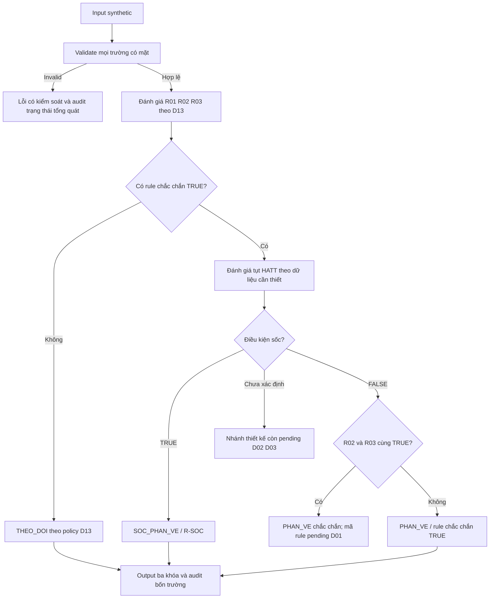

# M1-02 — Thiết kế luồng phân loại

## 1. Contract và nguyên tắc

Giữ `classify(patient)` và PatientInput chỉ dùng chín tên khóa trong Data Dictionary. Danh sách tên được phép không có nghĩa mọi khóa luôn bắt buộc. Kết quả thành công có đúng `muc_do`, `rule_id`, `ly_do`. Không thêm trường định danh hoặc UUID vào PatientInput.

Validation trước suy luận, kiểm tra mọi trường có mặt. Không ép chuỗi thành số/bool; bool không được dùng thay int. Tuổi nhận int/float hữu hạn >=0; HATT hiện tại int >=0 hoặc null; nền int >0 hoặc null; không đặt giới hạn trên tùy ý. Boolean có mặt phải đúng bool, null là invalid. Từ chối khóa dư. Thiếu boolean được biểu diễn UNKNOWN theo D13. Missing tuổi/HATT là trường hợp riêng, không gộp thành FALSE hoặc boolean UNKNOWN.

Miền số trên là quyết định validation nội bộ, không phải thêm ngưỡng lâm sàng. Kiểu exception, quy ước lỗi root input không phải dict, audit failure và context UUID còn cần ADR cụ thể; không tự khóa trong tài liệu này.

## 2. Biểu thức phải giữ nguyên

Ký hiệu nội bộ dùng để đọc tài liệu, không đổi tên khóa trong code/input:

| Ký hiệu | Khóa |
|---|---|
| S | co_di_nguyen_nghi_ngo |
| I | di_nguyen_qua_duong_hit |
| K | co_ton_thuong_da_niem_mac |
| H | co_trieu_chung_ho_hap |
| C | co_trieu_chung_tuan_hoan |
| G | co_trieu_chung_tieu_hoa_nang |

- R01 = NOT S AND K AND (H OR C).
- R02 = S AND ít nhất 2 TRUE trong K,H,C,G.
- R03 = S AND ((NOT I AND H) OR C).
- P = R01 OR R02 OR R03, tức thỏa ít nhất một rule phản vệ.
- R-SOC = P AND điều kiện tụt HATT theo tuổi. [D]

Tên R03 ghi “dị nguyên đã biết” nhưng biểu thức dùng S; giữ nguyên biểu thức nguồn, không thêm khóa “đã biết”. Đường hít chỉ chặn nhánh hô hấp R03, không chặn nhánh tuần hoàn và không chặn R02.

## 3. Logic ba trạng thái D13

Đây là chính sách nhóm, chưa phải xác nhận của TA. Missing boolean -> U; bool thật -> T/F; null/sai kiểu -> invalid ở validation.

| A | B | A AND B | A OR B |
|---|---|---|---|
| T | T | T | T |
| T | F | F | T |
| T | U | U | T |
| F | T | F | T |
| F | F | F | F |
| F | U | F | U |
| U | T | U | T |
| U | F | F | U |
| U | U | U | U |

NOT T=F, NOT F=T, NOT U=U. R02: gọi T_count là số hệ chắc chắn TRUE, U_count là số hệ thiếu. T_count>=2 -> điều kiện đếm TRUE; T_count+U_count<2 -> FALSE; còn lại UNKNOWN. Sau đó vẫn AND với S. Không dùng phép đếm truthy hoặc `patient.get(key, False)`. [Q §4.2]

Ví dụ: K=T,H=T,G=U,C=F thì điều kiện đếm R02 TRUE. K=T,H=F,G=U,C=F thì UNKNOWN. K=F,H=F,G=U,C=F thì FALSE.

## 4. Điều kiện huyết áp

| Tuổi | Nhánh tuyệt đối |
|---|---|
| 0 <= a <1 | b <70 |
| 1 <= a <11 | b <70+2*a |
| 11 <= a <18 | b <90 |
| a >=18 | b <90 OR giảm >30% so với nền |

So sánh nghiêm ngặt: bằng ngưỡng không thỏa nhánh đó. Với nền dương B ở người lớn, `(B-b)/B >0.30`; có thể đề xuất so sánh `10*b <7*B` để tránh sai số sát biên, Huy review trước khi code. Không làm tròn tuổi/ngưỡng; 10.99 cho ngưỡng 91.98, nhưng HATT input vẫn phải là int. [D; Q §4.1]

Thiếu tuổi/HATT không chứng minh điều kiện sốc FALSE. Ở người lớn b<90 đã TRUE thì không cần nền để xác nhận nhánh OR. Nếu b>=90 và nền thiếu/null, nhánh tương đối chưa xác định: giữ D03 pending. HATT thấp đơn độc nhưng P không TRUE không đủ kết luận sốc.

## 5. Luồng đề xuất

Các ô pending là ghi chú thiết kế, KHÔNG phải giá trị return hoặc exception runtime mới. Chưa viết nhánh code pending cho đến khi Huy có quyết định được phép áp dụng. Nếu chỉ có một rule TRUE và các rule khác U, chọn rule đã chắc chắn TRUE theo cách đọc Q §4.2; reviewer cần xác nhận cách chọn này trước triển khai.

Thứ tự xử lý: đánh giá Tầng 2 trước là phụ thuộc logic, không hạ ưu tiên Tầng 1. Chỉ return PHAN_VE sau khi biết không đạt sốc theo dữ liệu đủ kết luận. Khi sốc đã chắc chắn, không cần giải quyết mã overlap R02/R03 để return R-SOC.

## 6. Hàm hỗ trợ tối giản đề xuất cho ADR

| Thành phần | Trách nhiệm | Lý do |
|---|---|---|
| classify(patient) | Điều phối validation, rules, kết quả và audit | Giữ interface starter |
| validate_input(patient) | Kiểm tra allowlist/kiểu/miền, bảo toàn phân biệt missing-null | Không trộn lỗi dữ liệu với rule |
| evaluate_anaphylaxis(patient) | Trạng thái R01/R02/R03 theo D13 | Truy vết từng biểu thức |
| evaluate_hypotension(patient) | Đánh giá điều kiện theo tuổi và dữ liệu hiện có | Cô lập ranh giới huyết áp |
| audit writer riêng | Ghi đúng bốn trường từ context phiên | Việt Đức triển khai phần nhỏ, review cùng nhóm |

Đây là chia trách nhiệm, chưa khóa tên hàm/API nội bộ hoặc kiểu trả về. Không tạo framework rule engine, database hoặc hierarchy class. Với logic ba trạng thái, có thể dùng Enum/sentinel và hàm AND/OR/NOT nhỏ nếu giúp tránh ép bool; cần giải thích lợi ích so với nhánh if rõ ràng. Không chia quá nhiều helper chỉ để tăng số file.

## 7. Output, lỗi và audit

Output thành công đúng ba khóa; `ly_do` dùng mẫu gắn rule, không LLM, không số đo/triệu chứng thô hoặc khuyên điều trị. `THEO_DOI` không khẳng định an toàn. Mẫu câu cụ thể là đề xuất biên tập, không phải chuỗi expected bắt buộc. Invalid có lỗi có kiểm soát, không giả làm THEO_DOI.

Audit đúng `Timestamp`, `User_UUID`, `Action_Type`, `Status`; UUID phiên synthetic nằm ngoài PatientInput. D08 yêu cầu audit cả input lỗi, không payload/exception lộ raw input. Giá trị status, thời gian, cách truyền context và xử lý sink lỗi chưa khóa; chuyển Huy/Việt Đức duyệt trước M2. Benchmark sau này cần đo cả audit theo D10; M1 không cung cấp số đo.

## 8. Đóng góp ADR để Huy Đức tổng hợp

- Vấn đề: biểu thức ngắn dễ sai ngoặc, phép đếm và dữ liệu thiếu; cần kiểm chứng độc lập.
- Phương án đề xuất: giữ hàm điều phối nhỏ; tách validation, ba rule và điều kiện HATT; audit writer riêng.
- Lựa chọn khác: viết tất cả trong một hàm (ít lớp gọi nhưng khó review); dùng framework/DB (tăng phụ thuộc vượt nhu cầu).
- Đánh đổi: logic ba trạng thái tăng số ca test; bù lại không đánh đồng “chưa biết” với FALSE. Phải giữ D01–D03 pending.
- Cần Huy Đức duyệt thêm: lớp exception, input root không phải dict, context audit, lỗi ghi audit, thuộc tính không mutate input, chọn rule duy nhất TRUE khi rule khác U.
